# Esquema de datos del CMS

Estado: migraciones aplicadas y verificadas contra Supabase Local (PostgreSQL 17)
el 2026-11-11. Fuente de verdad: `supabase/migrations/*.sql`.

## 1. Principios

1. **PostgreSQL relacional primero.** Cada dato con relaciones, orden, filtros o
   integridad tiene tabla y columnas propias. `jsonb` solo se usa en
   `audit_log` para conservar la fila anterior/posterior; no hay configuración
   editorial opaca en `jsonb`.
2. **Una sola semántica de publicación.** Un registro es público si y solo si
   `status = 'published' AND is_visible = true`. La función
   `private.is_publicly_visible()` implementa el predicado; RLS y las consultas
   de `packages/db` lo aplican de forma explícita.
3. **RLS y GRANT juntos.** Tener un privilegio SQL no concede acceso si RLS no
   lo permite, y una política RLS no sirve sin el `GRANT` correspondiente.
4. **El rol administrativo vive en `app_metadata`.** `user_metadata` es
   editable por el usuario y nunca se consulta para autorizar.
5. **Los binarios viven en Storage.** PostgreSQL guarda metadatos, rutas y
   referencias; nunca el archivo.
6. **Auditoría append-only.** `audit_log` se escribe solo mediante triggers
   `SECURITY DEFINER`; los roles de la API no tienen `INSERT`.

## 2. Diagrama relacional

```mermaid
erDiagram
  media_assets ||--o{ profile : "avatar"
  media_assets ||--o{ projects : "cover"
  media_assets ||--o{ contact_links : "asset"
  sections ||--o{ section_ctas : "tiene"
  sections ||--o{ quotes : "tiene"
  projects ||--o{ project_technologies : "usa"
  technologies ||--o{ project_technologies : "aparece en"
  skill_categories ||--o{ skills : "agrupa"

  site_settings {
    boolean id PK
    text site_name
    text seo_title
    text seo_description
  }
  profile {
    boolean id PK
    text full_name
    uuid avatar_asset_id FK
  }
  sections {
    uuid id PK
    text key UK
    content_status status
    boolean is_visible
    int sort_order
  }
  nav_items {
    uuid id PK
    text label
    text href
    boolean is_cta
    content_status status
  }
  section_ctas {
    uuid id PK
    uuid section_id FK
    cta_variant variant
    content_status status
  }
  contact_links {
    uuid id PK
    text label UK
    text url
    uuid asset_id FK
    link_variant variant
  }
  projects {
    uuid id PK
    text slug UK
    project_layout layout
    uuid cover_asset_id FK
    content_status status
  }
  technologies {
    uuid id PK
    text name UK
    text slug UK
    boolean show_in_hero
    boolean show_in_tools
  }
  project_technologies {
    uuid project_id PK,FK
    uuid technology_id PK,FK
    int sort_order
  }
  skill_categories {
    uuid id PK
    text label UK
    text color
  }
  skills {
    uuid id PK
    uuid category_id FK
    text label
    smallint proficiency
  }
  profile_stats {
    uuid id PK
    text value
    text label UK
  }
  experiences {
    uuid id PK
    text year_label
    text role
    text company
  }
  quotes {
    uuid id PK
    uuid section_id FK
    text body
    text highlight
  }
  contact_messages {
    uuid id PK
    text name
    text email
    text message
    contact_message_status status
  }
  audit_log {
    bigint id PK
    uuid actor_id
    text operation
    text table_name
    jsonb old_data
    jsonb new_data
  }
```



## 3. Tipos enumerados

| Tipo | Valores | Uso |
|---|---|---|
| `content_status` | `draft`, `published`, `archived` | Ciclo de vida de todo contenido publicable |
| `project_layout` | `large`, `small` | Tamaño de la tarjeta de proyecto |
| `cta_variant` | `primary`, `secondary`, `text` | Estilo del botón de sección |
| `link_variant` | `button`, `icon` | Botón de contacto o red social |
| `contact_message_status` | `new`, `read`, `replied`, `archived`, `spam` | Bandeja de entrada |

## 4. Tablas

### 4.1 Configuración e identidad

- **`site_settings`** — fila única (`id = true`, `CHECK (id)`). SEO, Open Graph,
  footer y disponibilidad. `availability_href` solo admite `#`, `/` o `https://`.
- **`profile`** — fila única (`id = true`). `avatar_asset_id` referencia
  `media_assets` con `ON DELETE SET NULL`.
- **`media_assets`** — metadatos del binario. `UNIQUE (bucket, object_path)`,
  `CHECK` de bucket y prefijo:
  - `media` → `profile/%` o `projects/%`
  - `documents` → `resume/%`

### 4.2 Secciones y navegación

- **`sections`** — cinco claves fijas (`hero`, `about`, `projects`, `skills`,
  `contact`) mediante `CHECK` y `UNIQUE (key)`. `heading_highlight` debe ser
  subcadena exacta de `heading`. `marquee_words` es `text[]` porque es una
  secuencia ordenada de palabras decorativas.
- **`nav_items`** — `UNIQUE (label, href)` y un índice único parcial que impide
  más de un CTA (`is_cta = true`).
- **`section_ctas`** — `UNIQUE (section_id, label)`, `ON DELETE CASCADE`.
- **`contact_links`** — `UNIQUE (label)`. `url` o `asset_id` deben existir
  (`CHECK`). Un enlace `icon` exige `icon_key`; las claves admitidas son
  `github`, `linkedin`, `email`, `whatsapp`, `x`, `website`.

### 4.3 Proyectos y skills

- **`projects`** — `slug` único con formato kebab-case; dos colores `#RRGGBB`
  obligatorios (`accent_color`, `accent_color_alt`); `layout` obligatorio.
- **`technologies`** — `name` y `slug` únicos. `show_in_hero` exige
  `hero_sort_order`; `show_in_tools` exige `tools_sort_order` (`CHECK`).
- **`project_technologies`** — PK compuesta `(project_id, technology_id)`.
  `project_id` con `ON DELETE CASCADE`; `technology_id` con `ON DELETE RESTRICT`
  para no borrar una tecnología usada por proyectos.
- **`skill_categories`** — `label` único y color `#RRGGBB`.
- **`skills`** — `UNIQUE (category_id, label)`, `proficiency` entre 0 y 100,
  `ON DELETE CASCADE` desde la categoría.

### 4.4 Sobre mí

- **`profile_stats`** — `label` único; `value` es texto para admitir `∞` o `2+`.
- **`experiences`** — `UNIQUE (year_label, role, company)`; color obligatorio.
- **`quotes`** — `UNIQUE (section_id, label)`; `highlight` debe ser subcadena de
  `body`; `ON DELETE CASCADE` desde la sección.

### 4.5 Contacto y auditoría

- **`contact_messages`** — nombre 2..120, email normalizado a minúsculas con
  formato validado, asunto ≤ 200, mensaje 10..5000, página de origen ≤ 200.
  No hay `UNIQUE` de email: un remitente puede escribir varias veces.
- **`audit_log`** — `id` identity, actor, operación, tabla, `record_id`, fila
  anterior/posterior en `jsonb`. Solo lectura administrativa.

### 4.6 Orden y publicación

Todas las tablas de contenido tienen:

- `status content_status NOT NULL DEFAULT 'draft'`
- `is_visible boolean NOT NULL DEFAULT true`
- `sort_order integer NOT NULL DEFAULT 0`
- `published_at timestamptz` con `CHECK (status <> 'published' OR published_at IS NOT NULL)`
- trigger `set_published_at` que fija `published_at` al publicar si estaba nulo.

`is_visible` es un interruptor independiente: permite ocultar temporalmente algo
ya publicado sin volver a borrador.

## 5. Índices

Además de las PK y `UNIQUE`:

- Índices parciales `WHERE status = 'published' AND is_visible` en `sections`,
  `nav_items`, `contact_links`, `projects`, `technologies` (hero y tools),
  `skill_categories`, `profile_stats` y `experiences`.
- `section_ctas (section_id, sort_order)`, `skills (category_id, sort_order)`,
  `quotes (section_id, sort_order)`, `project_technologies (technology_id)`.
- `contact_messages (lower(email), created_at DESC)` para el rate limit del RPC
  y `(status, created_at DESC)` para la bandeja.
- `audit_log (table_name, occurred_at DESC)` y `(actor_id, occurred_at DESC)`.

## 6. RLS, GRANT y matriz de permisos

### 6.1 Helpers

| Función | Semántica |
|---|---|
| `private.is_publicly_visible(status, is_visible)` | `status = 'published' AND is_visible` |
| `private.is_admin()` | `auth.jwt() -> 'app_metadata' ->> 'role' = 'admin'` |
| `private.has_mfa()` | `auth.jwt() ->> 'aal' = 'aal2'` |

`private` no está expuesto por la Data API: se revoca `ALL` del esquema a
`PUBLIC` y solo se concede `USAGE` a `anon`/`authenticated` para ejecutar los
helpers necesarios.

### 6.2 Matriz por tabla

Leyenda: **P** = solo filas públicas (`published` + `is_visible`), **A** = todas
las filas, **—** = sin acceso, **Admin** = `private.is_admin()`,
**Admin+MFA** = `private.is_admin() AND private.has_mfa()`.

| Tabla | anon SELECT | authenticated SELECT | INSERT | UPDATE | DELETE |
|---|---|---|---|---|---|
| `sections` | P | P + Admin | Admin | Admin | Admin+MFA |
| `nav_items` | P | P + Admin | Admin | Admin | Admin+MFA |
| `section_ctas` | P y padre público | P + Admin | Admin | Admin | Admin+MFA |
| `contact_links` | P | P + Admin | Admin | Admin | Admin+MFA |
| `projects` | P | P + Admin | Admin | Admin | Admin+MFA |
| `technologies` | P | P + Admin | Admin | Admin | Admin+MFA |
| `project_technologies` | ambos extremos públicos | P + Admin | Admin | Admin | Admin+MFA |
| `skill_categories` | P | P + Admin | Admin | Admin | Admin+MFA |
| `skills` | P y categoría pública | P + Admin | Admin | Admin | Admin+MFA |
| `profile_stats` | P | P + Admin | Admin | Admin | Admin+MFA |
| `experiences` | P | P + Admin | Admin | Admin | Admin+MFA |
| `quotes` | P y sección pública | P + Admin | Admin | Admin | Admin+MFA |
| `site_settings` | A | A + Admin | Admin | Admin | Admin+MFA |
| `profile` | A | A + Admin | Admin | Admin | Admin+MFA |
| `media_assets` | A | A + Admin | Admin | Admin | Admin+MFA |
| `contact_messages` | — | Admin | — (solo RPC) | Admin | Admin+MFA |
| `audit_log` | — | Admin | — | — | — |

Notas:

- `anon` solo tiene `SELECT` sobre tablas de contenido, configuración, perfil y
  metadatos de medios. No tiene `INSERT`, `UPDATE` ni `DELETE`.
- `authenticated` tiene `GRANT` de escritura en las tablas de contenido, pero
  RLS la restringe a administradores. Un usuario autenticado normal no puede
  insertar, actualizar ni borrar.
- `contact_messages` no concede `INSERT` a ningún rol de API. La única vía es
  `public.submit_contact_message(...)`.
- `audit_log` no concede escritura a ningún rol de API; los triggers
  `SECURITY DEFINER` son los únicos que insertan.
- Las secuencias de `audit_log` están revocadas para `anon` y `authenticated`.

### 6.3 Defensa en profundidad en hijos

Las políticas de `section_ctas`, `skills` y `quotes` exigen que el padre
(`sections` o `skill_categories`) también sea público. Sin esto, un CTA o una
skill publicada bajo un padre oculto seguiría siendo legible por `anon`.
`project_technologies` exige que proyecto y tecnología sean públicos.

## 7. Funciones

### 7.1 `public.submit_contact_message(...)`

- `SECURITY DEFINER`, `search_path = ''`.
- Normaliza nombre, email, asunto, mensaje y página.
- Valida longitudes y formato de email.
- Rate limit por correo: 3 mensajes / 10 minutos y 20 / 24 horas.
- `EXECUTE` para `anon` y `authenticated`; no hay `INSERT` directo.
- Errores: `22023` (dato inválido), `P0001` (rate limit).
- El rate limit por IP, captcha y honeypot son responsabilidad del Route Handler
  de `apps/web` antes de invocar el RPC.

### 7.2 `public.replace_project_technologies(project_id, technology_ids)`

- `SECURITY DEFINER`, `search_path = ''`.
- Exige `private.is_admin()`; `EXECUTE` solo para `authenticated`.
- Valida que el proyecto exista y que todos los ids de tecnología existan.
- Borra e inserta la relación en una sola transacción, preservando el orden del
  array (`sort_order` = índice).
- No exige `aal2`: reemplazar los chips de un proyecto es una edición de
  contenido, no la destrucción del proyecto. El `DELETE` directo sobre
  `project_technologies` sí exige MFA.

## 8. Storage

### 8.1 Buckets

| Bucket | Público | Límite | MIME permitidos | Rutas |
|---|---|---|---|---|
| `media` | Sí | 5 MiB | `image/png`, `image/jpeg`, `image/webp`, `image/avif` | `profile/…`, `projects/…` |
| `documents` | Sí | 10 MiB | `application/pdf` | `resume/…` |

SVG y HTML no se permiten: son contenido activo y elevarían el riesgo de XSS
almacenado. Las imágenes se sirven desde un bucket público, pero solo un
administrador puede subir, reemplazar o borrar.

### 8.2 Políticas de `storage.objects`

| Operación | `media` | `documents` |
|---|---|---|
| SELECT | `anon`, `authenticated` | `anon`, `authenticated` |
| INSERT | admin y prefijo `profile`/`projects` | admin y prefijo `resume` |
| UPDATE | admin y prefijo permitido | admin y prefijo `resume` |
| DELETE | admin + aal2 | admin + aal2 |

La Storage API protege además `storage.objects` con un trigger que impide
`DELETE` directo desde SQL. La verificación RLS desactiva ese trigger dentro de
la transacción de prueba para poder ejercitar la política; la vía soportada en
producción es la Storage API.

### 8.3 Decisión sobre el CV

El CV (`CurrículumAnyeloFullStackDev.pdf`) se publica en el bucket público
`documents`, bajo `resume/`, porque el sitio ya lo ofrece como descarga abierta
en la sección de contacto. Es una decisión del responsable del repositorio.

Riesgo aceptado: el PDF contiene datos personales y queda accesible a cualquiera
que conozca la URL pública. Si esa exposición deja de ser aceptable, la
alternativa es:

1. Hacer el bucket privado.
2. Servir el CV mediante un Route Handler o Edge Function con `service_role`
   después de validar la solicitud.
3. Mantener la fila de `media_assets` y resolver la URL firmada en el servidor.

### 8.4 Archivos huérfanos

Borrar una fila de `media_assets` no borra el objeto de Storage. Las referencias
(`profile.avatar_asset_id`, `projects.cover_asset_id`,
`contact_links.asset_id`) usan `ON DELETE SET NULL` para no romper el contenido.
La limpieza de objetos sin metadato debe hacerse con la Storage API en una tarea
administrativa; no se automatiza en las migraciones.

## 9. Auditoría

Cada tabla de contenido tiene triggers `AFTER INSERT OR UPDATE OR DELETE` que
llaman a `private.audit_row_change()` (`SECURITY DEFINER`). El registro incluye:

- `actor_id` = `auth.uid()` (null en operaciones de sistema o anon)
- `actor_email` y `actor_role` del JWT
- `operation` (`INSERT`, `UPDATE`, `DELETE`)
- `table_name` y `record_id`
- `old_data` / `new_data` en `jsonb`

`project_technologies` no tiene columna `id`; su auditoría conserva la fila
completa en `old_data`/`new_data` y deja `record_id` nulo. La tabla no permite
`UPDATE` ni `DELETE` a roles de API; solo lectura administrativa.

## 10. Contratos de acceso tipado (`packages/db`)

### 10.1 Lectura para `apps/web`

```ts
import { createClient } from '@supabase/supabase-js';
import {
  getPublishedHomeContent,
  getPublishedProjects,
} from '@portfolio/db';

const supabase = createClient(
  process.env.NEXT_PUBLIC_SUPABASE_URL!,
  process.env.NEXT_PUBLIC_SUPABASE_ANON_KEY!,
);

const home = await getPublishedHomeContent(supabase);
```

- El cliente usa la clave anónima; nunca `service_role`.
- `getPublishedHomeContent` devuelve un agregado en `camelCase` con URLs de
  Storage resueltas (`MediaRef.url`).
- Cada consulta aplica `status = 'published' AND is_visible = true` además de
  RLS. Si una consulta falla, lanza `ContentError`; no devuelve contenido
  parcial silenciosamente.
- Consultas individuales disponibles: `getPublishedSiteSettings`,
  `getPublishedProfile`, `getPublishedSections`, `getPublishedNavItems`,
  `getPublishedSectionCtas`, `getPublishedContactLinks`, `getPublishedProjects`,
  `getPublishedHeroTechnologies`, `getPublishedToolsTechnologies`,
  `getPublishedSkillCategories`, `getPublishedProfileStats`,
  `getPublishedExperiences`, `getPublishedQuotes`.
- `apps/web` debe declarar `"@portfolio/db": "workspace:*"` y añadirlo a
  `transpilePackages` (o equivalente) en `next.config.ts`.

### 10.2 Escritura para `apps/admin`

```ts
import { createServerClient } from '@supabase/ssr';
import {
  createProject,
  updateProject,
  deleteProject,
  replaceProjectTechnologies,
} from '@portfolio/db';

const supabase = createServerClient(/* cookies + env */);

await createProject(supabase, { slug, title, /* … */ });
await updateProject(supabase, id, { status: 'published' });
await replaceProjectTechnologies(supabase, id, technologyIds);
await deleteProject(supabase, id); // requiere aal2
```

- El cliente debe llevar la sesión del administrador (SSR con cookies).
- La autorización real es RLS: `app_metadata.role = 'admin'`. Un usuario
  autenticado sin ese claim no puede escribir.
- `delete*` devuelve `false` cuando RLS bloquea el borrado (por ejemplo, falta
  MFA). No lanza error porque PostgREST responde con cero filas.
- `replaceProjectTechnologies` usa el RPC atómico y no requiere aal2.
- Los mensajes de contacto se gestionan con `listContactMessages`,
  `getContactMessage`, `updateContactMessageStatus` y `deleteContactMessage`.
- La creación pública de mensajes se hace desde `apps/web` con
  `submitContactMessage` (RPC), no con las mutaciones administrativas.

### 10.3 Variables y claves

- `NEXT_PUBLIC_SUPABASE_URL` y `NEXT_PUBLIC_SUPABASE_ANON_KEY`: seguras para el
  navegador; no conceden escritura por sí mismas.
- `SUPABASE_SERVICE_ROLE_KEY`: solo servidor, nunca en `NEXT_PUBLIC_*`. Se usa
  para bootstrap administrativo, tareas de mantenimiento y pruebas; no para el
  flujo ordinario del panel.

## 11. Conexiones y pooling

| Uso | Conexión recomendada |
|---|---|
| Migraciones y tareas administrativas | Conexión directa a PostgreSQL |
| `supabase db reset` / `db push` local | `127.0.0.1:54322` (config actual) |
| Aplicaciones serverless en producción | Pooler transaccional de Supabase |
| Procesos persistentes con prepared statements | Pooler en modo sesión o conexión directa, según compatibilidad |

Estado local: `[db.pooler] enabled = false`; la base directa escucha en
`54322`. En el proyecto hospedado, verifica en el dashboard el host y el puerto
del pooler antes de configurar variables; no asumas que `6543` o `5432` aplican
a todos los proyectos.

Si el cliente usa prepared statements, comprueba la compatibilidad del modo
elegido. En modo transaccional puede ser necesario desactivarlos (por ejemplo,
`prepare: false` en clientes tipo postgres.js o el parámetro equivalente del
ORM). El pooler transaccional no debe usarse para migraciones ni para comandos
que requieran una sesión estable.

## 12. MFA y operaciones sensibles

- `private.has_mfa()` solo devuelve `true` con `aal = 'aal2'`.
- Borrar contenido, medios, mensajes o enlaces exige `aal2`.
- En local, `[auth.mfa.totp]` está habilitado (`enroll_enabled = true`,
  `verify_enabled = true`) para poder probar el flujo completo.
- En el proyecto hospedado se debe habilitar TOTP y exigir su enrolamiento a
  los administradores. El claim `app_metadata.role` solo puede asignarlo un
  backend confiable (Admin API o SQL administrativo), nunca el propio usuario.
- Evidencia ejecutada: con sesión `aal1`, `deleteProject` devolvió `false`; tras
  enrolar y verificar TOTP, la misma operación devolvió `true`.

## 13. Limitaciones conocidas

- La verificación RLS se ejecutó contra **Supabase Local** (Docker), no contra
  un proyecto remoto. Cubre PostgreSQL, RLS, GRANT, Auth (claims simulados y
  MFA real), PostgREST (scripts de integración) y políticas de Storage.
- La prueba de `DELETE` en `storage.objects` desactiva el trigger
  `protect_objects_delete` dentro de una transacción; la Storage API real no
  permite ese `DELETE` directo.
- `apps/web` y `apps/admin` todavía no consumen `@portfolio/db`; la integración
  de dependencias, `transpilePackages`, variables de entorno y caché es
  responsabilidad del `cms-architect`.
- No se ha creado un proyecto Supabase remoto ni se han aplicado migraciones
  fuera del entorno local.
